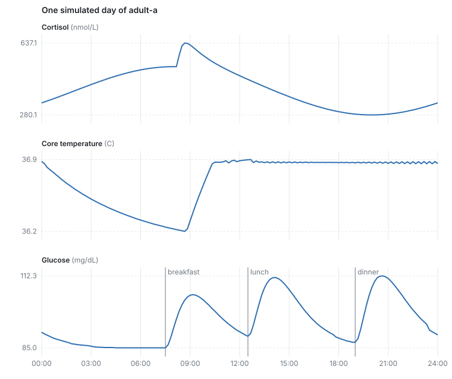

# bodysim

A deterministic simulation of a human body over days and weeks: sleep, the circadian clock, core temperature,
hydration and the bladder, digestion, glucose, heart rate, cortisol, caffeine and the menstrual cycle. Every
subsystem is a closed-form model that the engine jumps along from one threshold crossing to the next, so there is
no fixed time step, a year is cheap, and the same seed always gives the same body, bit for bit.



## Run it in under a minute

Rust 1.85 or newer (CI builds and tests on 1.85 and on stable). Clone this repository, then from its folder:

```sh
cargo run --release --example day -- 2 > day.csv       # two days of three example adults, every 10 minutes
python3 scripts/plot_day.py day.csv day.svg            # the picture above (standard library only)
cargo test                                             # 39 tests, about 7 s after the build
```

From a fresh clone to the plot took 15.3 s here, the first build included (400 MB peak memory).
After that a simulated day of three adults takes about 16 ms.

## How it works

- **Closed forms, not stepping.** Most quantities relax exponentially toward a target that changes when something
  happens (`x(t) = x_inf + (x0 - x_inf) e^-(t - t0)/tau`); others are linear, logistic, Bateman curves (drug
  absorption and the cortisol pulses) or a two-node thermal model. Each one is evaluated when it is looked at, and
  the time it will cross the next band (thirst "pressing", bladder "urgent") is solved for directly and scheduled.
- **Deterministic and replayable.** One seeded, keyed random stream; no wall clock and no unordered maps inside the
  simulation (enforced by `clippy.toml`); every applied change goes to a log that replays to the same state hash.
  A replay passes only if every checkpoint in the log was reached and matched: one that runs out of events before
  the log does is a failure, not a short pass.
- **Constants carry their source.** The 138 body constants live in `content/constants/body/*.ron`, each with a
  unit, a range, what it varies with, a source and a status: 73 Verified, 49 Tunable (chosen to make the model
  behave, with the reason), 9 Unverified, 7 Contested (sources disagree). The labels are the author's; anyone can
  check the source written next to each value.
- **A body needs a world.** `crates/body/src/room.rs` is the smallest one: a room at a steady temperature, meals and
  drinks injected from outside, and a toilet that answers a pressing bladder or bowel.

## Measured

**Glucose against a published glucose tolerance test.** A 75 g glucose drink after a night without food
(`crates/body/tests/ogtt.rs`), compared with the Hisayama Study (Hirakawa et al. 2020, BMJ Open Diabetes Res Care
8:e001156, Table 1: 2,162 adults aged 40 to 79 without diabetes):

| | fasting | 30 min | 2 h | 2 h minus fasting |
|---|---|---|---|---|
| bodysim | 85.0 | 138.8 | 100.0 | +15.0 |
| Hisayama, healthiest quarter (30 min at or below 135) | 92.7 | at or below 135 | 107.9 | +15.2 |
| Hisayama, second quarter (30 min 136 to 157) | 96.0 | 136 to 157 | 117.1 | +21.1 |

All values mg/dL. (The paper's table labels these columns mmol/L, but the values can only be mg/dL.) One constant
was fitted to get there: the plasma rise per gram absorbed, 1.75 mg/dL, below the 7.7 you would get if a whole gram
spread through about 130 dL of glucose space with nothing taken up on the way.

**Speed.** `cargo run --release --example bench -- DAYS`, three adults with three meals and five toilet visits a
day, Intel i5-14400F:

| run length | simulated days per second | events per second |
|---|---|---|
| 30 days | 114 | 148,000 |
| 365 days | 118 | 152,500 (471,998 events in 3.1 s, the median of 8 runs) |

Four things made it this fast, and none changed a single bit of the result (same events, same state hash, the
day's CSV identical byte for byte):

- **A year used to cost five times more per day than a month** (4.9 days per second): the bench schedules every
  meal of the run up front, and cancelling one kind of pending event walked all of a person's thousands of future
  events. The event list now keeps an index per person and kind.
- **The thermal model was 76% of a run.** Each time a body's temperature segment ends, it asks when the next of
  sixteen thresholds will be crossed, and it sampled the same trajectory again for every one of them. It is
  sampled once for all sixteen now, and only the thresholds crossed in the earliest interval are solved exactly.
  A year went from 15.6 s to 4.9 s. A test checks 400 generated cases against asking one threshold at a time.
- **Constants are looked up by name, and a crossing search asks its question over a hundred times.** The hunger
  search looked up the same two constants on every one of them. Looked up once, a year took 3.7 s.
- **Every constant read also walked the system's list of declared constants** and counted itself in a map keyed
  by the name. One lookup now finds the row, and the check and the count go by its index. A year went from 3.54 s
  to 3.17 s (the medians of five runs, each run alternating with the old binary). A test pins the read counts and
  the undeclared read they report.

## Limits

- **The three example adults are nearly the same person.** They share every constant; their curves differ by less
  than 1 C in core temperature and 0.3 mg/dL in glucose.
- **Glucose is the linear, decoupled case** of the Bergman minimal model: insulin follows glucose but does not act
  on it. A solid meal of 60 to 80 g of carbohydrate peaks 20 to 27 mg/dL up, about 100 minutes after eating (the
  solid-meal gastric emptying lag); real mixed meals usually peak earlier.
- **Core temperature follows sleep more than the clock.** It falls through the night to its low at waking and then
  sits near 36.9 C with a small sawtooth; the usual low is around 04:00 to 06:00. The room is held at 27 C because
  there is no bedding yet; at 21 C a lightly clothed sleeper would get far too cold.
- **Cortisol's evening low is too high** (about 280 nmol/L at 20:00; real values fall much lower by midnight). The
  awakening peak (637 nmol/L about 30 minutes after waking) is in the normal range.
- **Not medical software.** It is a model for simulations and games, not for diagnosis or dosing.

## Layout

```
crates/core    the engine: world, components, rules, relations, the event queue, the replay log, closed forms
crates/body    the body: one plugin per subsystem, the room, three example adults, tests and examples
content        constants with sources, and the example people
scripts        the plot
```

Built with AI pair programming.

## Licence

MIT
